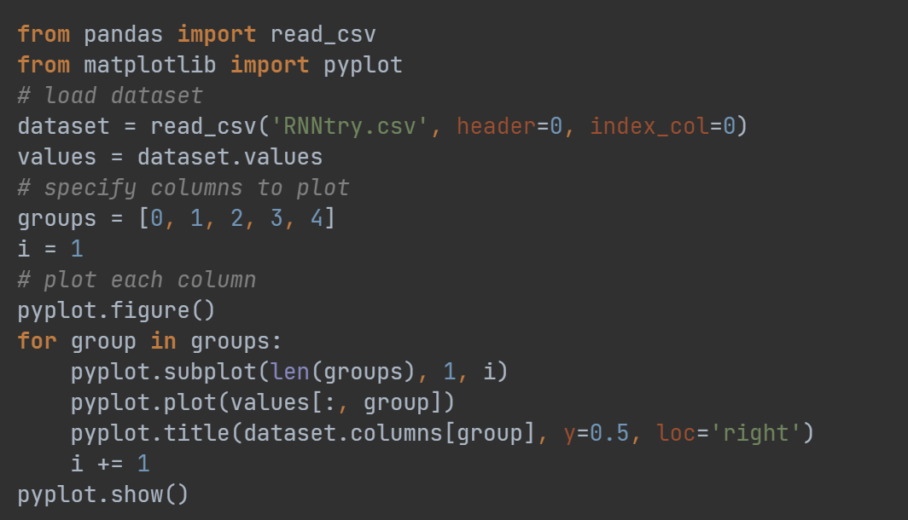

# Prediction of Solar Power Generation Based on LSTM Neural Network (Python Code Implementation)

Based on LSTM Neural Network for Predicting Solar Power Generation (Python Code Implementation)
Part of the code:
\n        \n      Increased production of renewable energy is beneficial to the environment, but it poses challenges to grid stability. Therefore, predicting this energy becomes very important. This study uses an LSTM neural network to predict solar power generation. Data from BSRN (with a time range of 1 minute) was used to build the model. Humidity, dew point/frost point, tower pressure, number of months and days were found to be most suitable for predicting solar radiation. Additionally, extensive discussions were made about model tuning, evaluation, and testing. Analysis of the power spectral density of the predicted values indicated that it was difficult to predict at low frequencies. The LSTM model showed promising results overall and can be used for various data sizes.

## Images

<!-- PAYMENT_BLOCK -->

## Get this dataset

- Payment link (Stripe): [Buy now](https://buy.stripe.com/3cs8yP7sY87d0vu9AB)
- Payment QR code: 

<!-- /PAYMENT_BLOCK -->
